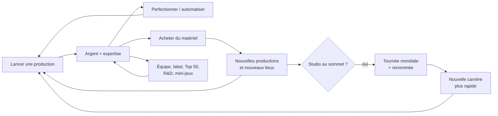

# Premier Mix

**Premier Mix** est un jeu de gestion « idle » en 3D : tu montes ton studio de musique, d'un ordinateur portable dans ta chambre jusqu'au complexe légendaire, avec ton équipe, ton label, tes artistes et tes tournées à travers le monde.

> **Jouer tout de suite** : <https://hugokirbach.github.io/music-studio-tycoon/>
> Le jeu tient dans un seul fichier (`www/index.html`) et fonctionne sur ordinateur comme sur téléphone.

*Document de référence du jeu : il est mis à jour à chaque nouvelle version (voir [Historique des versions](#historique-des-versions)).*

---

## Sommaire

1. [Le principe en 30 secondes](#le-principe-en-30-secondes)
2. [La boucle de jeu](#la-boucle-de-jeu)
3. [Les premières minutes](#les-premières-minutes)
4. [L'écran de jeu](#lécran-de-jeu)
5. [Productions](#productions)
6. [Matériel et lieux](#matériel-et-lieux)
7. [Expertise, catalogue et valeur du studio](#expertise-catalogue-et-valeur-du-studio)
8. [Équipe](#équipe)
9. [Commandes clients](#commandes-clients)
10. [Sorties de studio](#sorties-de-studio)
11. [Top 50 et tendances](#top-50-et-tendances)
12. [Projets de création](#projets-de-création)
13. [Recherche (R&D)](#recherche-rd)
14. [Label et artistes](#label-et-artistes)
15. [Mini-jeux](#mini-jeux)
16. [Tournée mondiale (prestige)](#tournée-mondiale-prestige)
17. [Palmarès](#palmarès)
18. [Décoration, souvenirs et globe](#décoration-souvenirs-et-globe)
19. [Absence et débrief](#absence-et-débrief)
20. [Réglages et sauvegardes](#réglages-et-sauvegardes)
21. [Tableau des déblocages](#tableau-des-déblocages)
22. [Historique des versions](#historique-des-versions)
23. [Installer les applications](#installer-les-applications)
24. [Modifier le jeu (développeurs)](#modifier-le-jeu-développeurs)

---

## Le principe en 30 secondes

- Tu **lances des productions** (beats, mixages, singles, albums…) qui rapportent de l'argent et de l'expertise.
- Tu **perfectionnes** et **automatises** ces productions pour qu'elles tournent seules.
- Tu **achètes du matériel**, qui débloque de nouvelles productions et fait grandir ton studio jusqu'à de nouveaux lieux.
- Tu recrutes une **équipe**, tu signes des **artistes**, tu grimpes au **Top 50**.
- Quand ton studio est au sommet, tu pars en **tournée mondiale** : tu recommences avec ta **renommée**, qui rend chaque nouvelle carrière plus rapide.

Le cœur du jeu reste simple : **attendre, cliquer, réinvestir**. Tout le reste (mini-jeux, label, tournées…) est un bonus qui accélère ta progression sans jamais être obligatoire.

---

## La boucle de jeu



| Échelle de temps | Ce que tu fais |
| --- | --- |
| **Quelques secondes** | Cliquer pour accélérer une production, acheter un perfectionnement. |
| **Quelques minutes** | Acheter du matériel, recruter, accepter une commande, répondre à une sortie de studio, jouer un clash. |
| **Une session** | Changer de lieu, sortir des titres au Top 50, produire un album pour un artiste, envoyer un artiste en tournée locale. |
| **Plusieurs jours** | Préparer et partir en tournée mondiale, collectionner les souvenirs, monter tout le palmarès. |

---

## Les premières minutes

1. Clique sur **Lancer** sous « Composer un beat ». Clique encore pendant la production pour l'**accélérer**.
2. Avec tes premiers euros, **perfectionne** la production (elle rapporte plus) puis **automatise**-la (elle se relance seule).
3. Achète le **casque fermé** dans l'onglet **Matériel** : tu débloques « Mixer un morceau ».
4. Continue : chaque nouvel équipement ouvre une production plus rentable, et ton studio déménage dès que sa valeur le permet.
5. Vers le niveau d'expertise 2 à 6, de nouveaux systèmes s'ouvrent un par un (commandes, équipe, clashs, Top 50, projets, label). Un message t'annonce chaque nouveauté.

---

## L'écran de jeu

- **En haut** : ton lieu actuel et sa progression, puis les compteurs **Budget** (avec le revenu par seconde et la renommée), **Valeur** du studio, **Expertise** (niveau) et **Catalogue** (titres produits).
- **Au centre** : ton studio en **3D**. Tu peux tourner la caméra, zoomer et cliquer sur les éléments : matériel, membres de l'équipe, artistes, affiches. Des **bulles** au-dessus des objets ouvrent les activités : clash sur la batterie, atelier sur le piano, décoration sur l'étagère, globe, artistes qui ont quelque chose à dire.
- **Les onglets** : Prod, Matériel, Équipe, R&D, Top 50, Palmarès, Réglages. Une **pastille** signale qu'il y a quelque chose à faire dans un onglet.
- **Sur téléphone**, le menu est un panneau qu'on peut réduire. Les détails facultatifs (descriptions, paliers, étoiles, aides) sont rangés derrière un petit **« i »** pour gagner de la place.
- **Mode nuit** : le studio s'éclaire de lampes et de néons.

---

## Productions

Il y a **11 productions**, de la plus simple à la plus rentable :

| Production | Expertise requise | Équipement requis |
| --- | --- | --- |
| Composer un beat | 1 | — |
| Mixer un morceau | 2 | Casque fermé |
| Enregistrer une voix | 4 | Micro à condensateur |
| Produire un single | 6 | Interface audio |
| Réaliser un EP | 9 | Enceintes de monitoring |
| Enregistrer un album | 12 | Traitement acoustique |
| Composer une BO | 15 | Console analogique |
| Capter une session live | 17 | Cabine de prise de son |
| Masteriser pour un label | 20 | Chaîne de mastering |
| Produire un album de star | 23 | Grande salle (Studio A) |
| Signer un hit mondial | 26 | Console légendaire |

**Actions sur une production**

- **Lancer / Accélérer** : chaque clic fait gagner un peu de temps à la production en cours.
- **Perfectionner** (« Améliorer » sur mobile) : la production rapporte plus. Le sélecteur **×1 / ×10 / ×25 / Max** achète plusieurs rangs d'un coup.
- **Automatiser** : la production se relance toute seule, même quand tu n'es pas là.
- **Mixer** : un mini-jeu qui améliore la qualité et les gains du prochain titre (voir [Mini-jeux](#mini-jeux)).

### Paliers de maîtrise

Chaque production gagne des **paliers** en montant en rang. Chacun apporte un effet différent :

| Rang | Palier | Effet |
| --- | --- | --- |
| 10 | Rodé | Production 50 % plus rapide |
| 25 | Signature | Gains ×2 |
| 50 | Hit-maker | 12 % de chances de sortir un **tube** qui rapporte ×10 |
| 75 | Catalogue culte | Royalties de cette production ×3, gains ×1,3 |
| 100 | Locomotive | Gains ×2 et **+5 % de gains pour toutes tes productions** |
| 150 | Virtuose | Production 25 % plus rapide |
| 200 | Légende | Gains ×1,5 et 15 % de tubes |

Les tubes s'affichent en doré (« Tube ! ») et sont comptés sous chaque production.

### Qualité

Chaque production a une **qualité de 1 à 5 étoiles**. Elle dépend du lieu, du membre de l'équipe qui y travaille et du mixage. La qualité compte pour les commandes clients et pour le Top 50.

---

## Matériel et lieux

L'onglet **Matériel** propose **25 équipements**, de l'ordinateur portable au mur de disques d'or. Chaque équipement :

- débloque une production, augmente les gains ou l'expertise, ou ouvre une fonctionnalité (le **clavier maître MIDI** ouvre l'atelier piano, par exemple) ;
- augmente la **valeur du studio**.

Quand la valeur dépasse un seuil, le studio **déménage** :

| Lieu | Valeur requise | Particularités |
| --- | --- | --- |
| Ta chambre | 0 € | Le début de l'aventure |
| Chambre-studio | 1 k€ | — |
| Le garage | 20 k€ | Plus de place pour l'équipe et les artistes |
| Local en ville | 500 k€ | — |
| Studio professionnel | 15 M€ | — |
| Studio de référence | 400 M€ | — |
| Complexe légendaire | 35 Md€ | Le plus grand studio |

Chaque lieu offre plus de postes pour l'équipe et peut accueillir plus d'artistes signés.

---

## Expertise, catalogue et valeur du studio

- **Expertise** : chaque production terminée donne des points. Chaque niveau augmente tous tes gains de 4 % et débloque de nouvelles productions et de nouveaux systèmes.
- **Catalogue** : chaque titre produit rejoint ton catalogue et rapporte des **royalties** en continu.
- **Valeur du studio** : la somme de ton matériel. Elle multiplie tes gains et décide de ton lieu.
- **Unités** : k (millier), M (million), Md (milliard), Bn (billion = mille milliards), puis Brd et Tn.

---

## Équipe

Dès le niveau d'expertise 3, l'onglet **Équipe** permet de recruter parmi des **candidats** (de 1 à 5 étoiles). Il y a **7 métiers** :

| Métier | Excelle sur |
| --- | --- |
| Beatmaker | Beat, single, hit mondial |
| Ingé mix | Mixage, EP, album |
| Coach vocal | Voix, single, session live |
| Réalisateur | EP, album, album de star |
| Compositeur | BO, hit mondial, beat |
| Ingé mastering | Mastering, album, album de star |
| Preneur de son | Session live, voix, mixage |

- Chaque membre est **affecté à une production** : elle va plus vite et rapporte plus, surtout si elle correspond à son métier.
- Les membres **gagnent des niveaux** en travaillant ou en **formation**. Leur salaire suit la réussite du studio.
- Le **moral** baisse avec le travail. Une **prime** ou des **vacances** le remontent. Un membre à 0 % de moral finit par **démissionner**, sauf quand tu es absent.
- **Pendant ton absence, l'équipe se repose** : son moral remonte de 0 à 100 % en 3 h.
- Les anciens membres peuvent revenir **sans prime d'embauche** après une tournée mondiale.
- L'onglet Équipe regroupe aussi les vues **Label** et **Discographie** (voir [Label et artistes](#label-et-artistes)).

---

## Commandes clients

Dès le niveau 2, des clients t'appellent (onglet **Prod**) :

- Chaque commande demande **un nombre de titres d'une production**, parfois avec une **qualité minimale**, dans un temps limité.
- Une commande livrée rapporte une prime et de la **réputation** (jusqu'à 100). Une commande ratée en fait perdre.
- La réputation augmente les primes des commandes et ton score au Top 50.

---

## Sorties de studio

Régulièrement, une **rencontre** t'attend hors du studio : il y en a **36 différentes** (rappeur du café, micro ouvert, panne en pleine nuit, pianiste du métro…).

- Chaque rencontre propose **2 ou 3 choix**. Certains coûtent de l'argent, demandent un équipement, un membre de l'équipe ou un niveau, ou sont **risqués**.
- Les bons choix rapportent de l'argent, de la réputation, des points de recherche, un titre mixé… et parfois un **contact**.
- Chaque contact donne **+2 % de gains pour toujours**. Certains contacts ouvrent des **histoires en plusieurs épisodes** ou des **artistes à signer**.

---

## Top 50 et tendances

Dès le niveau 4, l'onglet **Top 50** s'ouvre :

- **Sortir un titre** : un titre mixé (ou une sortie gratuite par semaine) entre au classement face à 50 studios rivaux. Une **campagne promo** le place plus haut.
- Chaque **semaine de jeu (3 minutes)**, tes titres classés rapportent selon leur place, puis vieillissent et redescendent.
- Les **tendances de la semaine** changent chaque semaine :
  - une **production en vogue** (+25 % de gains, plus de commandes et mieux payées) ;
  - un **genre** et une **ambiance** que le public réclame (bonus pour les projets de création) ;
  - une **règle de clash** (tempo rapide, sans clap, grosse prime).
- **Pendant ton absence**, les semaines continuent de passer et tes titres classés rapportent : à plein rendement si le jeu reste ouvert, à rendement réduit s'il est fermé.

---

## Projets de création

Dès le niveau 5, dans l'onglet **Top 50**, tu peux lancer un **projet** (single, EP ou album) en choisissant :

- un **genre** (Rap, Pop, Électro, Lo-fi, Chanson française, Afro, R&B, Trap, Rock, Jazz, K-pop, Bande originale) ;
- une **ambiance** (Amour, Fête, La rue, Nostalgie, Révolte, Voyage, Spleen, Espoir) ;
- un **public** (Ados, Jeunes adultes, Grand public, Connaisseurs) ;
- un **dosage** pour chaque phase (écriture, enregistrement, production) et un **membre de l'équipe** par phase.

Le projet avance pendant que le studio continue de tourner. À la fin, **4 critiques** donnent leur note sur 10. Le projet entre au Top 50 et se vend pendant plusieurs semaines. Le **carnet du studio** garde en mémoire les associations genre/ambiance qui marchent.

---

## Recherche (R&D)

Le studio accumule des **points de recherche** en produisant, en mixant, en livrant des commandes et au Top 50. L'onglet **R&D** propose **18 recherches** dans 3 branches :

- **Technique** : vitesse, mixage, qualité (Raccourcis clavier, Auto-Tune, Dolby Atmos…).
- **Création** : projets, tubes, critiques (Carnet d'idées, Signature sonore, Génie créatif…).
- **Business** : commandes, Top 50, salaires (Réseau professionnel, Attaché de presse, Empire musical…).

Les recherches sont **définitives**, même après une tournée. Deux **spécialisations** (après 5 puis 11 recherches) se choisissent à nouveau à chaque carrière : Usine à tubes, Studio de prestige, Studio indépendant, puis Faiseur de stars, Maison de formation, Artisan du son.

---

## Label et artistes

Dès le niveau 6, tu crées ton **label** (onglet **Équipe → Label**). **14 artistes** peuvent être signés. Certains sont rencontrés en sortie de studio, d'autres sont repérés quand ton studio grandit. Le nombre d'artistes dépend de ton lieu.

### Albums

- Chaque artiste a un **genre** et **deux ambiances préférées**.
- Quand il **veut sortir un album** (petite note ♪ au-dessus de lui dans le studio), prépare-le avec l'outil de projet de création.
- Respecter ses goûts fait grimper sa **notoriété** et son **humeur**. La notoriété de tes artistes augmente **tous tes gains**.

### Histoires d'artistes

Tes artistes viennent te parler (bulle au-dessus d'eux) : envie de changer de style, duo avec un autre artiste du label, coups de tête… Tes choix modifient leur humeur, leur notoriété et leurs prochains albums.

### Concerts

Un concert se joue au **mini-jeu de batterie**. La salle dépend de la notoriété de l'artiste : bar, salle de quartier, salle de concert, Zénith, stade. Un bon concert rapporte une recette, de la notoriété et de l'humeur.

### Labels rivaux

Quand un artiste devient connu, un **label rival** peut tenter de le débaucher. Tu as trois réponses :

- verser une **prime de fidélité** : l'artiste reste à coup sûr ;
- **lui faire confiance** : il reste selon son humeur ;
- **accepter son départ** contre une indemnité de transfert.

Sans réponse, l'artiste décide seul. Un artiste parti revient sur le marché après un moment.

### Tournées locales

Bouton **Tournée** sur la carte d'un artiste : il part jouer dans les villes du **pays où ton studio est installé** (France au début), avec toujours une finale dans la capitale.

- Tu choisis :
  - la **taille** : 3, 5 ou 8 villes ;
  - le **transport** : van économique mais fatigant, bus confortable, avion plus rapide ;
  - la **setlist** : ses classiques (sûrs), les nouveaux titres (risqués), un show spectaculaire (cher mais rentable).
- Un **aperçu** affiche le coût, la durée, les chances de réussite et les gains estimés.
- La tournée avance **en temps réel, même quand le jeu est fermé**.
- Des **imprévus** arrivent en route : panne, interview radio, rappel du public, perte de voix, featuring surprise… Chacun propose deux réponses. Sans réponse, le choix le plus prudent s'applique.
- L'artiste est **indisponible** pendant la tournée (pas d'album, pas de concert), puis se repose quelques minutes.

### Discographie

La vue **Discographie** liste tous les albums du label : note, entrée au classement, semaine de sortie, et artistes partis.

---

## Mini-jeux

Tous les mini-jeux sont **facultatifs** et jouables à la souris, au clavier ou au doigt. Le son des mini-jeux a son propre réglage.

| Mini-jeu | Où | Principe | Récompense |
| --- | --- | --- | --- |
| **Mixage** | Bouton Mixer d'une production | Arrêter chaque fader dans la zone verte | Qualité (étoiles) et gains du titre |
| **Clash à la batterie** | Bulle sur la batterie, onglet Prod | Rythme sur 4 pads (D, F, J, K), deux notes simultanées au plus, métronome désactivable | Argent, réputation, montée de ligue |
| **Duel au piano** | Bulle sur le piano | « Piano tiles » : toucher les tuiles noires de bas en haut sans en rater | Comme le clash |
| **Atelier piano** | Bulle sur le piano (avec le clavier MIDI) | Piano tiles sur des mélodies connues, qui accélère, ou jeu libre | **Inspiration** : gains multipliés pendant quelques minutes |
| **Concert** | Carte d'un artiste | Batterie, au tempo du genre de l'artiste | Recette, notoriété, humeur |

Les clashs montent en **ligues** : Quartier, Régionale, Nationale, Internationale, Légende. Un rival se présente régulièrement. Une fois le clavier installé, un clash sur deux se joue au piano.

---

## Tournée mondiale (prestige)

Quand ton studio a assez gagné, l'onglet **Palmarès** propose de **partir en tournée mondiale** :

- Tu repars d'un ordinateur portable : budget, expertise, matériel, perfectionnements et catalogue sont remis à zéro.
- Tu gagnes des **points de renommée**. Chaque point donne **+15 % de gains** et **+5 % d'expertise**, pour toujours.
- Tu gardes ta renommée, tes contacts, tes trophées, tes recherches, ton label, ton classement et tes souvenirs.

### Préparer la tournée

Chaque carrière propose **8 grandes dates**, tirées parmi 12 salles mythiques. Chacune se confirme quand tu relèves son défi :

| Salle | Pays | Défi |
| --- | --- | --- |
| Paris, l'Olympia | France | Classer un titre n°1 du Top 50 |
| Marseille, le Vélodrome | France | Livrer 25 commandes |
| Londres, Wembley | Royaume-Uni | Un artiste à 90 de notoriété |
| Manchester, l'Apollo | Royaume-Uni | Une équipe au complet à 80 % de moral |
| New York, le Madison Square Garden | États-Unis | Gagner 3 clashs |
| Los Angeles, le Hollywood Bowl | États-Unis | Une production au rang 100 |
| Tokyo, le Budokan | Japon | 60 tuiles au piano |
| Osaka, le Kyocera Dome | Japon | 3 titres dans le top 10 en même temps |
| Rio de Janeiro, le Maracanã | Brésil | 3 concerts avec tes artistes |
| São Paulo, l'Allianz Parque | Brésil | 2 tournées locales |
| Lagos, l'Eko Convention Center | Nigeria | Un projet noté 9/10 |
| Berlin, le Berghain | Allemagne | 50 tubes |

- Les défis comptent ce que tu réalises **pendant la carrière en cours**, et ils grandissent de 25 % à chaque tournée.
- Chaque date confirmée ajoute **+12 % de renommée** au départ, avec **+30 % en plus** si toutes les dates sont confirmées.
- Chaque date jouée devient un **souvenir** : **+2 % de gains pour toujours**, et une affiche dans le studio.
- Au départ, tu **choisis le pays** où installer ton studio pour la carrière suivante, parmi les pays où tu as joué. Les tournées locales de tes artistes se feront alors dans les villes de ce pays.

---

## Palmarès

L'onglet **Palmarès** compte **42 familles de trophées** (production, fortune, équipe, clashs, label, tournées, tubes…). Chacune a plusieurs niveaux : Bronze, Argent, Or, Platine, Diamant, Légende.

- Chaque niveau décroché donne **+1 % de gains**, pour toujours.
- Le **prochain objectif** est affiché en haut de l'onglet Prod.
- Les trophées au niveau Or garnissent l'**étagère à souvenirs** du studio.

---

## Décoration, souvenirs et globe

- **Décoration** (bulle sur l'étagère) : peinture des murs, sol, tapis, ambiance lumineuse et néon mural. Certaines options se débloquent avec le palmarès. La décoration est purement esthétique et reste après une tournée.
- **Affiches de tournée** : une affiche encadrée par date de la tournée mondiale jouée, et une par pays parcouru en tournée locale. Elles se placent automatiquement sur les murs libres.
- **Globe** : un globe sur pied apparaît dans le studio. Il ouvre un **globe interactif** que tu fais tourner et zoomer :
  - le pays de ton studio en jaune, les pays parcourus en orange ;
  - les villes jouées en points blancs, les dates mondiales en étoiles ;
  - une fiche détaillée par pays.

---

## Absence et débrief

Le jeu continue sans toi :

- **Jeu fermé** : la production tourne à **50 %**, jusqu'à **6 h** d'absence. Le Top 50 et les tournées locales avancent aussi.
- **Jeu ouvert en arrière-plan** (autre onglet, écran verrouillé) : le studio tourne à **plein régime**.
- Personne ne démissionne pendant ton absence, et l'équipe se repose.

À ton retour, un **débrief** affiche :

- la durée d'absence ;
- les revenus bruts, dont la part du Top 50 et des ventes d'albums ;
- les salaires versés et le bilan exact sur ton budget (avant → après) ;
- les productions réalisées et les niveaux gagnés ;
- le moral de l'équipe et les retours de tournée.

---

## Réglages et sauvegardes

- **Sons** : deux réglages séparés, l'un pour les **sons du studio** (gains d'argent), l'autre pour les **sons des mini-jeux**.
- **Thème** clair ou sombre, et **caméra** réinitialisable.
- **Sauvegardes** :
  - sur **claude.ai**, la partie est synchronisée avec ton compte Claude ;
  - sur **GitHub Pages** et dans les applications **.exe** et **.apk**, la partie est sauvegardée sur l'appareil ;
  - pour passer d'un appareil à l'autre, utilise **Copier mon code** puis **Importer un code** dans l'onglet Réglages.

---

## Tableau des déblocages

| Niveau d'expertise | Nouveauté |
| --- | --- |
| 1 | Composer un beat, matériel, sorties de studio |
| 2 | Commandes clients |
| 3 | Équipe, clashs de beatmakers |
| 4 | Top 50 et tendances |
| 5 | Projets de création |
| 6 | Label (artistes, concerts, tournées locales), préparation de la tournée mondiale |
| Clavier maître MIDI | Atelier piano et duels au piano |
| 5 et 11 recherches | Spécialisations de R&D |
| Seuil de renommée | Tournée mondiale |

---

## Historique des versions

*Les entrées les plus récentes sont en haut. Chaque mise à jour du jeu ajoute une ligne ici.*

| Date | Nouveautés |
| --- | --- |
| 15/10/2026 | Documentation complète du jeu (ce document). |
| 14/10/2026 | Version mobile compacte, détails derrière un « i ». Souvenirs de tournée en 3D et globe interactif. Tournée mondiale à préparer (8 dates, choix du pays). Tournées locales des artistes avec imprévus. Paliers de maîtrise à effets variés et tubes. Débrief d'absence exact (salaires, bilan, Top 50). Top 50 actif pendant l'absence, équipe au repos. Personnages 3D articulés. Clash simplifié avec métronome, duels et atelier « piano tiles », sons séparés, menus réorganisés. Labels rivaux, discographie, artistes visibles en 3D. |
| 13/10/2026 | Label : signature, albums, histoires et concerts. Tendances hebdomadaires. Décoration du studio. Clashs de beatmakers et atelier piano. Achat ×10/×25/Max. 36 sorties de studio. Palmarès à plusieurs niveaux. Projets de création. Recherche (R&D). Mode nuit plus lumineux. Version jouable sur GitHub Pages. |

---

## Installer les applications

Le jeu est aussi emballé en applications :

- **Windows** avec Electron : un installateur `.exe` et une version portable `.exe`.
- **Android** avec Capacitor : un fichier `.apk`.

À chaque envoi sur la branche `main`, GitHub compile tout seul les deux applications (onglet **Actions**, environ 10 minutes) et les publie dans l'onglet **Releases** du dépôt :

| Fichier | Pour quoi faire |
| --- | --- |
| `PremierMix-Installation-1.0.0.exe` | Installe le jeu sur Windows, avec un raccourci sur le bureau. |
| `PremierMix-Portable-1.0.0.exe` | Lance le jeu directement, sans installation. |
| `PremierMix.apk` | Installe le jeu sur un téléphone ou une tablette Android. |

La version web sur GitHub Pages est republiée automatiquement à chaque envoi sur `main`.

### Windows : avertissement SmartScreen

L'application n'est pas signée avec un certificat payant, donc Windows peut afficher « Windows a protégé votre ordinateur ». Clique sur **Informations complémentaires**, puis sur **Exécuter quand même**.

### Android : installer l'APK

1. Télécharge `PremierMix.apk` depuis la page Releases, directement sur le téléphone.
2. Ouvre le fichier. Android te demande d'autoriser l'installation d'applications inconnues pour ton navigateur (ou ton gestionnaire de fichiers) : accepte.
3. Lance **Premier Mix**.

L'APK est signé avec une clé de développement. Il s'installe sans problème, mais il n'est pas destiné au Play Store. Pour une publication sur le Play Store, il faudra une clé de signature à toi.

---

## Modifier le jeu (développeurs)

Le code source du jeu est dans `game/` :

| Fichier | Rôle |
| --- | --- |
| `data.js` | Toutes les données et l'équilibrage : productions, matériel, lieux, paliers, sorties, trophées, métiers, R&D, projets, clashs, piano, label, tournées, pays et carte du monde. |
| `engine.js` | Le moteur de jeu : logique pure, sans affichage, testable avec Node. |
| `scene3d.js` | La scène 3D (Three.js r160, licence MIT) : pièces, matériel, personnages, souvenirs, globe. |
| `ui.js` et `template.html` | L'interface : onglets, fenêtres, mini-jeux, styles. |
| `build.py` | Assemble le tout dans `www/index.html`. |
| `tests/` | Tests du moteur (un fichier par système). |

Après une modification :

```
python game/build.py                               # régénère www/index.html
for t in game/tests/*test.js; do node "$t"; done   # lance tous les tests du moteur
```

Envoie ensuite la modification sur `main` : GitHub republie la version web et recompile les applications. Pense à ajouter une ligne dans l'[Historique des versions](#historique-des-versions).

### Compiler sur ton propre PC (facultatif)

Il faut Node.js 20 :

```
npm install
npm start            # lance le jeu dans une fenêtre
npm run dist:win     # fabrique les .exe dans release/ (sous Windows)
```

Pour l'APK sur ton PC, il faut en plus Android Studio (avec le SDK Android) et Java 17 :

```
npm run android:prepare
npm run android:apk  # APK dans android/app/build/outputs/apk/debug/
```
